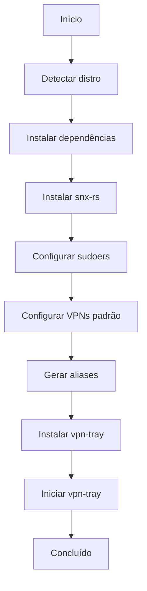
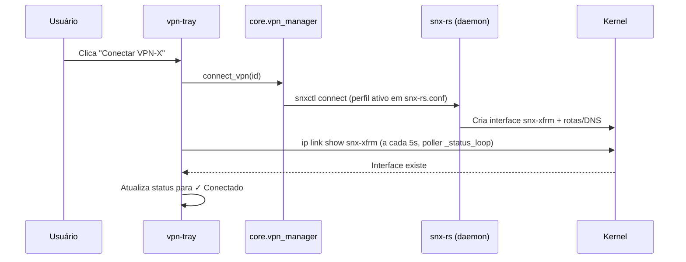

# Arquitetura do vpn-egsys

## Visão Geral da Arquitetura

O **vpn-egsys** é um sistema modular multi-protocolo (**Check Point SNX** e **IPsec — IKEv1 XAuth+PSK (padrão) / IKEv2 swanctl**) e cross-platform (**Linux** e **macOS**), composto pelas seguintes camadas:

```
┌─────────────────────────────────────────────────────────────────────────────┐
│                            vpn-egsys v2.2                                   │
├─────────────────────────────────────────────────────────────────────────────┤
│                                                                             │
│  ┌───────────────────────┐                    ┌──────────────────────────┐  │
│  │  vpn-tray (Bandeja)   │                    │   vpn CLI (Terminal)     │  │
│  │  Linux: Gtk/Ayatana   │                    │   Linux & macOS          │  │
│  │  macOS: pystray/AppKit│                    │   list/connect/add/status│  │
│  └───────────┬───────────┘                    └────────────┬─────────────┘  │
│              │                                             │                │
│              └──────────────────────┬──────────────────────┘                │
│                                     ▼                                       │
│               ┌───────────────────────────────────────────┐                 │
│               │             core.vpn_manager              │                 │
│               │   (Abstração de SO e Protocolos)          │                 │
│               └─────────────────────┬─────────────────────┘                 │
│                                     │                                       │
│         ┌───────────────────────────┴───────────────────────────┐           │
│         ▼                                                       ▼           │
│  ┌──────────────┐                                         ┌──────────────┐  │
│  │ Linux Engine │                                         │ macOS Engine │  │
│  │ • snx-rs svc │                                         │ • launchd    │  │
│  │ • NetworkMgr │                                         │ • scutil --nc│  │
│  │ • strongSwan │                                         │ • networkset.│  │
│  └──────────────┘                                         └──────────────┘  │
│                                                                             │
│  ┌───────────────────────────────────────────────────────────────────────┐  │
│  │                    ~/.config/snx-rs/ (0600)                           │  │
│  │      vpnro.conf, vpnpr.conf, vpnam.conf, vpnsc.conf (IPsec)...        │  │
│  └───────────────────────────────────────────────────────────────────────┘  │
└─────────────────────────────────────────────────────────────────────────────┘
```

> **Nota (v2.2)**: no Linux Engine, o NetworkMgr atende **somente SNX** (dummy-iface). O IPsec é
> tratado pelo strongSwan **nativo** — stroke (IKEv1 XAuth+PSK, padrão) e swanctl (IKEv2) — via
> helper privilegiado `vpn-ipsec-apply` (materializa os blocos gerenciados em
> `/etc/ipsec.conf`/`/etc/ipsec.secrets` e `/etc/swanctl/conf.d/vpn-egsys.conf) e `vpn-ipsec-ctl`
> (up/down/status, v2.2.4). O plugin
> strongSwan do NM (IKEv2-only) foi removido do caminho.

---

## Componentes Principais

### 1. Scripts de Instalação e Configuração

#### `install.sh` - Instalador

**Responsabilidades:**
- Detecção do sistema operacional
- Instalação de dependências
- Instalação do `snx-rs`
- Configuração do sudoers
- Configuração das VPNs padrão
- Geração de aliases
- Instalação do vpn-tray

**Fluxo de Execução:**



**Dependências por Distro:**

| Distro | Dependências |
|--------|--------------|
| Debian/Ubuntu | python3-gi, gir1.2-gtk-3.0, gir1.2-ayatanaappindicator3-0.1, libwebkit2gtk |
| Arch | python-gobject, gtk3, libayatana-appindicator, webkit2gtk |
| Fedora/RHEL | python3-gobject, gtk3, libayatana-appindicator-gtk3, webkit2gtk4.1 |

#### `uninstall.sh` - Desinstalador

**Responsabilidades:**
- Parar processos (vpn-tray, snx-rs)
- Remover arquivos instalados
- Remover configurações do sudoers
- Remover aliases
- Opcionalmente remover configurações de VPN

**O que NÃO faz:**
- Não remove o pacote `snx-rs` (requer comando manual)

---

### 2. Gerenciador de VPNs (`update.sh`)

**Arquitetura:**

```
┌─────────────────────────────────────────────────────────┐
│                     update.sh                             │
├─────────────────────────────────────────────────────────┤
│  ┌──────────────┐  ┌──────────────┐  ┌──────────────┐   │
│  │   list_vpns   │  │   add_vpn    │  │  update_vpn  │   │
│  │   ()         │  │   ()         │  │   ()         │   │
│  └──────┬───────┘  └──────┬───────┘  └──────┬───────┘   │
│         │                │                │            │
│         └────────────────┼────────────────┘            │
│                          ▼                                 │
│              ┌───────────────────┐                       │
│              │  ~/.config/snx-rs/ │                       │
│              │  vpn*.conf        │                       │
│              └────────┬──────────┘                       │
│                       │                                     │
│          ┌────────────┴────────────┐                    │
│          ▼                         ▼                    │
│   ┌──────────────┐          ┌──────────────┐            │
│   │ regenerate_  │          │  update_tray  │            │
│   │ aliases()    │          │  ()          │            │
│   └──────┬───────┘          └──────────────┘            │
│          │                                                │
│          ▼                                                │
│   ┌──────────────┐                                        │
│   │ .bashrc/.zshrc│                                        │
│   └──────────────┘                                        │
└─────────────────────────────────────────────────────────┘
```

**Funções Principais:**

| Função | Descrição | Arquivo Modificado |
|--------|-----------|-------------------|
| `list_vpns()` | Lista VPNs configuradas com servidor e usuário | stdout |
| `add_vpn()` | Adiciona nova VPN com credenciais | `~/.config/snx-rs/vpn*.conf` |
| `update_vpn()` | Atualiza credenciais de VPN existente | `~/.config/snx-rs/vpn*.conf` |
| `remove_vpn()` | Remove VPN | `~/.config/snx-rs/vpn*.conf` |
| `regenerate_aliases()` | Recria aliases no shell | `.bashrc`, `.zshrc` |
| `update_tray()` | Reinicia vpn-tray | Processos |
| Bloco **10b** — backend IPsec (v2.2.1, ampliado na v2.2.4) | Provisiona o lado privilegiado: copia `core/` + `vpn-ipsec-apply` + `vpn-ipsec-ctl` para `/usr/lib/vpn-egsys`, regrava `/etc/sudoers.d/vpn-egsys` com dois caminhos exatos (validado com `visudo -c`), habilita `strongswan-starter` e roda `vpn-ipsec-apply` (que agora também faz `rereadsecrets`/`reload`) | `/usr/lib/vpn-egsys/*`, `/etc/sudoers.d/vpn-egsys`, unidades systemd, `/etc/ipsec.*` |
| Guarda de **paridade IKEv1** (v2.2.5, só em distro com `pacman`) | `install.sh`/`update.sh` testam a presença de `task_manager_v1` no `libcharon` e do pin `IgnorePkg = strongswan` no `/etc/pacman.conf`, e emitem `warn` quando falta o IKEv1 ou quando o rebuild está vulnerável a ser substituído por update do repositório | Nenhum (somente aviso no output) |

> Desde a v2.2.1, `git pull && ./update.sh` cobre **100%** do cliente em máquina já instalada
> (userland + helper/sudoers/starter), espelhando a seção 11b do `install.sh`.

**Formato do Arquivo de Configuração (vpn*.conf):**

```ini
server-name=131.72.155.42
user-name=usuario
password=base64_encoded_password
ignore-server-cert=true
login-type=vpn
```

Perfil IPsec (IKEv1 XAuth+PSK — padrão; ver `docs/IPSEC.md`):

```ini
protocol=ipsec
ipsec-type=ikev1-xauth        # ou ikev2 (swanctl)
server-name=138.185.153.20
user-name=usuario
password=base64_encoded_password
psk=base64_encoded_psk
routes=172.20.100.0/24
ike=aes256-sha256-modp2048!   # opcional (default do projeto)
esp=aes256-sha256-modp1536!   # opcional (default do projeto)
```

> ⚠️ **Segurança**: A senha é armazenada em base64, o que não é criptografia. Considerar usar um keyring para armazenamento seguro.

---

### 3. Monitor de Bandeja (`vpn-tray`)

**Tecnologias:**
- **Linguagem**: Python 3
- **GUI**: GTK 3 via PyGObject
- **AppIndicator**: Ayatana AppIndicator 3
- **Monitoramento**: thread poller único (`_status_loop`, a cada 5s) + UI atualizada via
  `GLib.idle_add` com callback retornando `False` [v2.2.7]

**Arquitetura:**

```python
class VPNTray:
    ├── __init__()
    │   ├── discover_vpns()  # Descobre VPNs em ~/.config/snx-rs/
    │   ├── build_menu()    # Constrói menu GTK
    │   └── check_status()  # Verifica status inicial
    ├── discover_vpns()
    │   ├── glob.glob("~/.config/snx-rs/vpn*.conf")
    │   └── parseia server-name para label
    ├── build_menu()
    │   ├── status_item (✗ Desconectado / ✓ Conectado)
    │   ├── itens para cada VPN (Conectar {label})
    │   ├── Desconectar
    │   └── Sair
    ├── get_active_vpn()
    │   ├── check ip link show snx-xfrm
    │   └── check ps aux para processo snx-rs
    ├── check_status() / _status_loop() [v2.2.4, corrigido em v2.2.7]
    │   ├── thread poller único (daemon) a cada 5s — GetLayout do painel nunca bloqueia
    │   ├── Atualiza ícone (vpn-connected/vpn-disconnected) via GLib.idle_add
    │   ├── check_status() retorna False (v2.2.7) — retorno True em idle_add = fork storm
    │   └── Atualiza título e label de status
    ├── on_connect() / _async_connect() [v2.2.2]
    │   ├── threading.Thread(daemon=True) — conexão assíncrona não-bloqueante
    │   ├── status_item exibe "⌛ Conectando {label}..." imediatamente
    │   ├── core.vpn_manager.connect_vpn(id)
    │   │   ├── SNX   → snxctl connect (daemon command mode) + nmcli up <label>
    │   │   └── IPsec → vpn-ipsec-apply → vpn-ipsec-ctl stroke/swanctl up [v2.2.4]
    │   ├── GLib.idle_add(self.check_status) — atualização segura da UI
    │   │   └── check_status() retorna **False** [v2.2.7] — em idle_add, True re-agenda
    │   │       o source para sempre e gerava fork storm (thread + sudo stroke status
    │   │       por passo; ~5.500 chamadas/min na estação Ubuntu)
    │   └── notify-send — notificação nativa no desktop
    ├── on_disconnect() / _async_disconnect() [v2.2.2]
    │   ├── threading.Thread(daemon=True) — desconexão assíncrona
    │   └── core.vpn_manager.disconnect_all()
    └── on_quit()
        └── Gtk.main_quit()
```

**Fluxo de Conexão:**



**Localizações Importantes:**

| Arquivo | Local | Propósito |
|---------|-------|-----------|
| `vpn-tray` | `~/.local/bin/` | Binário executável |
| Ícones | `~/.local/share/icons/vpn-egsys/` | Ícones SVG |
| Desktop Entry | `~/.local/share/applications/vpn-egsys.desktop` | Lançador |
| Autostart | `~/.config/autostart/vpn-tray.desktop` | Início automático |
| Logs | `/tmp/snx-rs.log` | Logs do snx-rs |
| Lock | `/run/snx-rs.lock` | Lock file do snx-rs |

---

## Fluxo de Dados

### 1. Fluxo de Instalação

```
User
  │
  ▼
./install.sh
  │
  ├── detect_distro() → /etc/os-release
  │       │
  │       ▼
  │   PKG_MANAGER (apt/pacman/dnf)
  │
  ├── install_deps() → sudo apt/pacman/dnf install
  │
  ├── install_snx_rs() → curl + download snx-rs
  │
  ├── setup_sudoers() → /etc/sudoers.d/vpn-egsys
  │
  ├── setup_vpn() → ~/.config/snx-rs/vpn*.conf
  │
  ├── setup_aliases() → ~/.bashrc, ~/.zshrc
  │
  └── install_tray() → ~/.local/bin/vpn-tray, icons, autostart
```

### 2. Fluxo de Conexão VPN

SNX (command mode, vigente desde v2.0; o modo standalone legado foi removido do caminho):

```
User → vpn/vpn-tray → connect_vpn() → VPNBackend.connect_snx()
  │
  ├── snxctl disconnect (+ nmcli connection down <label>)
  ├── cópia do perfil vpnXX.conf → ~/.config/snx-rs/snx-rs.conf (0600)
  ├── snxctl connect            (dialoga com o daemon snx-rs -m command)
  └── nmcli connection up <label>   (dummy-iface snx-XX do NM)
        daemon: systemd unit snx-rs.service (snx-rs -m command, auto-restart)
```

Fluxo IPsec (Linux):

```
User → vpn/vpn-tray → connect_vpn() → VPNBackend.connect_ipsec_linux()
  │
  ├── sudo /usr/lib/vpn-egsys/vpn-ipsec-apply   (materializa perfis vpn*.conf nos
  │        │                                     blocos gerenciados de /etc)
  │        ├── /etc/ipsec.conf        (conn stroke IKEv1, BEGIN/END vpn-egsys)
  │        ├── /etc/ipsec.secrets     (PSK + XAUTH, 0600, bloco gerenciado)
  │        └── /etc/swanctl/conf.d/vpn-egsys.conf (perfis ikev2)
  │
  ├── ikev1-xauth → sudo vpn-ipsec-ctl stroke up vpnXX    (strongswan-starter)
  ├── ikev2       → sudo vpn-ipsec-ctl swanctl up vpnXX   (--initiate --ike)
  └── verificação: SA INSTALLED via sudo vpn-ipsec-ctl * status (rc 0 sozinho NÃO conecta)
```

> v2.2.4: todo up/down/status passa pelo wrapper `/usr/lib/vpn-egsys/vpn-ipsec-ctl` (sudoers com
> caminhos exatos, sem curingas — exigência do `sudo-rs` 0.2.8). O core (`ipsec_cli()`) cai para
> as chamadas brutas `ipsec`/`swanctl` apenas se o ctl não estiver instalado.

> v2.2.5: antes de culpar a credencial, o core chama `charon_ikev1_missing()`, que inspeciona o
> `libcharon` instalado em busca de `task_manager_v1`. Em strongSwan ≥ 6 o IKEv1 é opcional de
> build e os pacotes Arch/CachyOS não o embarcam — o charon aborta o conn com
> `IKE version 1 not supported` sem falar com o gateway. Nesse caso a falha vira mensagem
> específica (rebuild `--enable-ikev1` + `IgnorePkg = strongswan`) em vez do genérico
> "verifique credenciais no gateway". Em 6.x o código v1 compila dentro de `libcharon`, portanto
> **não** existe `libstrongswan-ikev1.so` para listar.

### 3. Fluxo de Monitoramento

```
threading.Thread(_status_loop, daemon=True)  — poller único de longa duração (v2.2.4)
  │   (antes: GLib.timeout_add_seconds(3, check_status) síncrono — congelava o
  │    ícone no painel GNOME quando o status demorava mais que o timeout do GetLayout)
  └── a cada 5s: get_active_vpn() → GLib.idle_add(_apply_status)
      │
      ├── get_active_vpn()
      │   ├── ip link show snx-xfrm
      │   └── ps aux | grep snx-rs
      │
      └── Atualiza UI (na thread Gtk, via idle_add):
          ├── indicator.set_icon_full()
          ├── indicator.set_title()
          └── status_item.set_label()

Invariantes de callback GLib [v2.2.7] — cobertos por tests/test_tray_idle.py:
  · todo callback registrado em GLib.idle_add(self.X) DEVE retornar False
    (True mantém o source ativo e o GLib o re-invoca continuamente)
  · check_status() é disparado por _async_connect/_async_disconnect como
    atualização única — o poller _status_loop é o único dono do ciclo de status
  · shebang do vpn-tray pinado em /usr/bin/python3 (env python3 no PATH da
    sessão resolve o linuxbrew, que não tem PyGObject → import gi falha)
  · [v2.2.8] install.sh/update.sh normalizam DBUS_SESSION_BUS_ADDRESS antes do
    nohup do tray (coberto por tests/test_tray_bus_env.py): a libdbus rejeita
    endereço sem ":" (caminho puro) em silêncio e o Ayatana cai para XEmbed —
    sem StatusNotifierItem, o menu fica inacessível via D-Bus no KDE/Wayland;
    caminho puro recebe prefixo unix:path= e, sem a variável, os scripts
    constroem unix:path=/run/user/<uid-alvo>/bus

run_linux_tray(): RLIMIT_NOFILE elevado a 8192 (v2.2.4) — evita exaustão de fds
quando subprocessos de status são criados em ciclo
```

---

## Configurações e Arquivos

### Arquivos de Configuração

| Arquivo | Local | Formato | Permissões |
|---------|-------|---------|-------------|
| vpn*.conf | `~/.config/snx-rs/` | INI-like | 600 |
| snx-rs.conf (perfil ativo) | `~/.config/snx-rs/` | INI-like | 600 |
| sudoers vpn-egsys | `/etc/sudoers.d/` | Text | 0440 |
| ipsec.conf / ipsec.secrets | `/etc/` | stroke (bloco `# BEGIN/END vpn-egsys (managed)`) | 600 (secrets) |
| vpn-egsys.conf | `/etc/swanctl/conf.d/` | swanctl (IKEv2) | 600 |
| .bashrc/.zshrc | `~/` | Bash | 644 |

### Arquivos Instalados

| Arquivo | Local | Tipo |
|---------|-------|------|
| vpn-tray | `~/.local/bin/` | Script Python |
| vpn (CLI) | `~/.local/bin/` | Script Python |
| core/vpn_manager.py | `~/.local/bin/core/` | Módulo Python (userland) |
| core/ + vpn-ipsec-apply + vpn-ipsec-ctl | `/usr/lib/vpn-egsys/` | Helpers privilegiados root (0755) |
| *.svg | `~/.local/share/icons/vpn-egsys/` | Ícones |
| vpn-egsys.desktop | `~/.local/share/applications/` | Desktop Entry |
| vpn-tray.desktop | `~/.config/autostart/` | Autostart |

### Processos

| Processo | Comando | Descrição |
|----------|---------|-----------|
| vpn-tray | `python3 ~/.local/bin/vpn-tray` | Monitor de bandeja |
| snx-rs (daemon) | `snx-rs -m command` (via `snx-rs.service`) | Serviço SNX em command mode |
| charon (strongSwan) | `strongswan-starter.service` | Daemon IPsec (conns stroke de /etc/ipsec.conf) |

---

## Segurança

### Permissões Sudoers

Desde a v2.2.0 o `/etc/sudoers.d/vpn-egsys` instalado pelo `install.sh`/`update.sh` contém
**somente** o conjunto restrito do backend IPsec (validado com `visudo -cf` antes de aplicar, 0440
root:root). Desde a v2.2.4 são **dois caminhos exatos, sem curingas** — o `sudo-rs` 0.2.8
(Ubuntu 25.10+) não casa coringa de argumento em regra NOPASSWD (nem `vpn*`, nem ` *`), e toda a
flexibilidade migrou para o wrapper `vpn-ipsec-ctl`, que revalida o nome (`^vpn[a-z0-9_-]{2,40}$`)
e executa argv fixo do strongSwan. A restrição real vem dos nomes de conexão, sempre sanitizados
para `vpn[a-z0-9]+` e materializados apenas por root:

```
USER ALL=(root) NOPASSWD: /usr/lib/vpn-egsys/vpn-ipsec-apply, /usr/lib/vpn-egsys/vpn-ipsec-ctl
```

O caminho SNX dispensa sudo: o daemon roda como serviço systemd (`snx-rs.service`) e os binários
`/usr/bin/snx-rs`/`snxctl` recebem SUID; as regras NOPASSWD legadas
(`snx-rs`, `killall snx-rs`, `rm -f /run/snx-rs.lock`) não são mais escritas — se um host antigo
ainda as possuir, podem ser removidas com `sudo rm /etc/sudoers.d/vpn-egsys && ./update.sh`.

**Riscos residuais:**
- NOPASSWD apenas para os dois scripts gerenciados (`vpn-ipsec-apply`/`vpn-ipsec-ctl`) — desde a
  v2.2.4 nenhum binário strongSwan está diretamente no sudoers; o ctl só aceita nomes de conn no
  formato `vpn[a-z0-9_-]{2,40}` e os nomes só existem porque o helper os materializa como root em
  `/etc/ipsec.conf` (escopo fixo entre marcadores `# BEGIN/END vpn-egsys (managed)`)

**Mitigações:**
- Arquivo com permissões 0440 (root:root)
- Validado com `visudo -cf` antes de aplicar (se inválido, NÃO é instalado)
- Apenas o usuário atual tem permissões (USER)

### Armazenamento de Senhas

As senhas são armazenadas em base64 nos arquivos `.conf`:

```ini
password=base64_encoded_string
```

**Riscos:**
- Base64 não é criptografia, apenas encoding
- Arquivos `.conf` têm permissão 600 (somente usuário)
- Qualquer usuário root pode ler as senhas

**Melhorias Sugeridas:**
- Usar `libsecret` ou `gnome-keyring` para armazenamento seguro
- Criptografar senhas com uma master key
- Usar `snx-rs` com `--password-command` para injeção dinâmica

---

## Dependências Externas

### Pacotes de Sistema

| Pacote | Versão Mínima | Propósito |
|--------|---------------|-----------|
| python3 | 3.6+ | Linguagem principal |
| python3-gi | - | GObject Introspection |
| gir1.2-gtk-3.0 | 3.0 | GTK3 bindings |
| gir1.2-ayatanaappindicator3-0.1 | 0.1 | AppIndicator |
| libwebkit2gtk | 4.0+ | Dependência do AppIndicator |
| strongswan | 6.x | Backend IPsec (stroke `ipsec` + `swanctl`; unit `strongswan-starter`) |

### snx-rs

| Versão | Download | Instalação |
|--------|----------|------------|
| 6.0.6 (pin; command mode requer >= 5.0) | GitHub Releases | DEB (Debian) / tar.gz (Arch/Fedora) |

**URL Base:** `https://github.com/ancwrd1/snx-rs/releases/download/v{version}/`

---

## Ambiente de Execução

### Variáveis de Ambiente Relevantes

| Variável | Valor Padrão | Propósito |
|----------|--------------|-----------|
| `HOME` | `/home/user` | Localização de arquivos de configuração |
| `PATH` | - | Include `~/.local/bin` |
| `DISPLAY` | `:0` | Display X11 para GTK |
| `XDG_RUNTIME_DIR` | `/run/user/{uid}` | Runtime directory |

### Arquivos de Estado

| Arquivo | Local | Propósito |
|---------|-------|-----------|
| `snx-rs.log` | `/tmp/` | Logs da conexão VPN |
| `snx-rs.lock` | `/run/` | Lock file para prevenir múltiplas instâncias |
| `vpn-tray` | Processo | PID do monitor |

---

## Resumo Técnico

| Aspecto | Valor |
|---------|-------|
| **Linguagens** | Bash, Python 3 |
| **Frameworks** | GTK3, PyGObject, Ayatana AppIndicator |
| **Total de Linhas** | ~3.860 (Bash + Python, incluindo suíte de testes) |
| **Arquivos de Código** | 13 (install.sh, update.sh, uninstall.sh, user-setup.sh, nm-snx-setup.sh, 99-snx-vpn.sh, vpn, vpn-tray, vpn-ipsec-apply, vpn-ipsec-ctl, core/vpn_manager.py, tests/×3) + `macos/` |
| **Arquivos de Configuração** | 1 (README.md, LICENSE, .gitignore, package.json) |
| **Ícones** | 2 (SVG) |
| **Documentação** | 6+ (README + docs/) |
